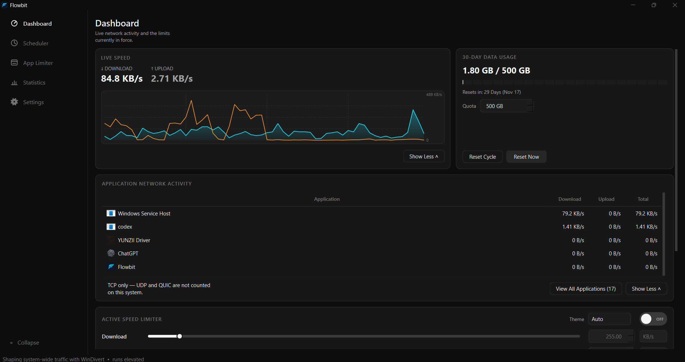
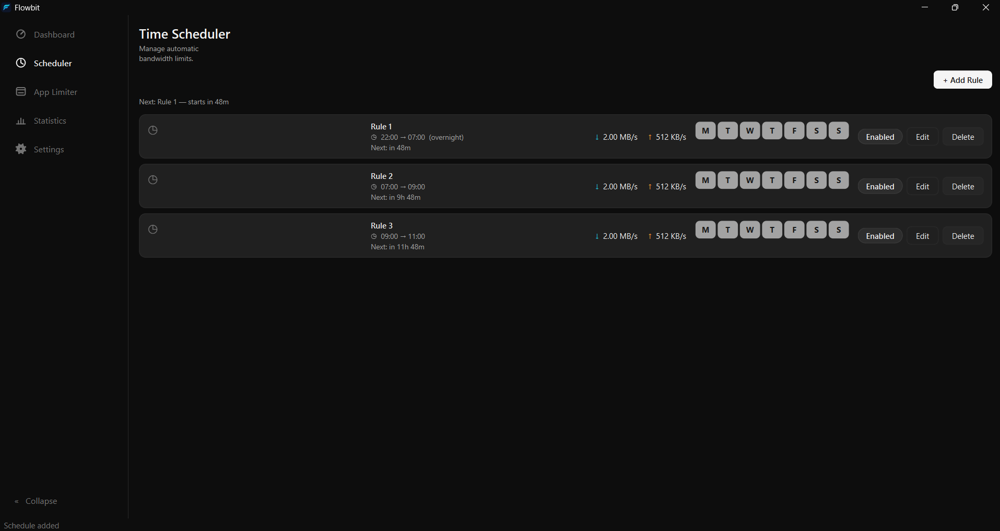
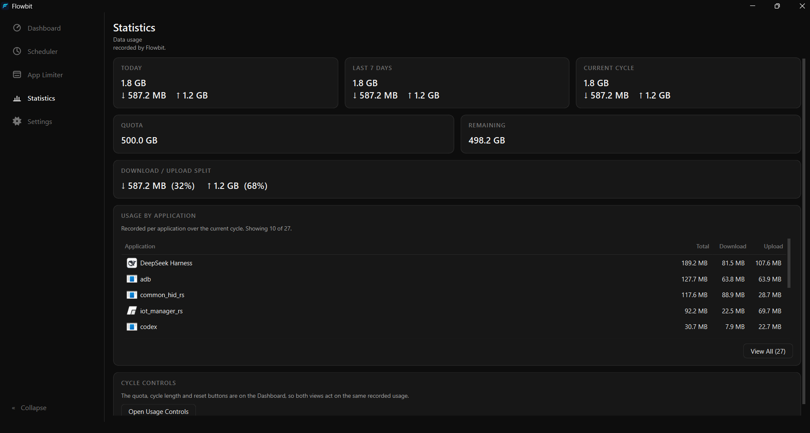
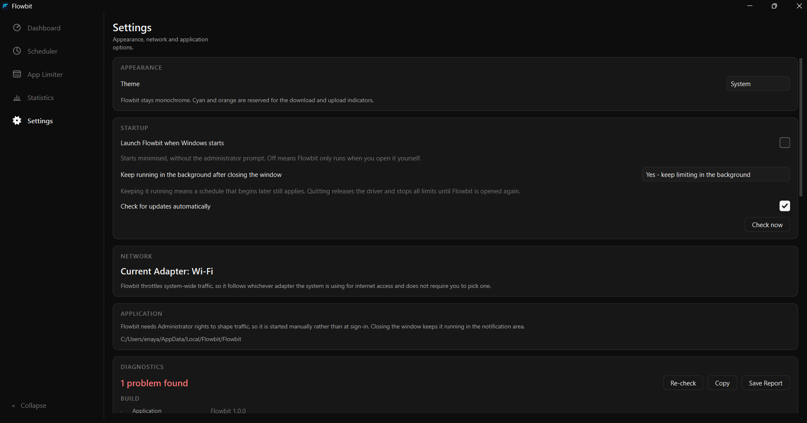

# Flowbit

A Windows bandwidth limiter with per-application control, hourly schedules, and live
per-app network monitoring.

Flowbit caps your internet speed either **system-wide** or **per application**, and
either can be governed by a **schedule**. On top of that it shows you, live, which
applications are actually using the connection.


## Features

- **System-wide limits** — set global download and upload caps. `0` means unlimited.
- **Per-application limits** — add any `.exe` and give it its own download/upload caps.
  These are additive to the system-wide cap, so the tighter of the two applies and
  nothing else is affected. Several applications can hold different limits at once.
- **Schedules** — rules like `22:00 → 07:00 at 2048/512 KB/s`, on the system-wide
  limit or on any individual application. Windows wrap past midnight, weekday masks
  are supported, and rules open and close automatically. Each rule has its own id,
  and any of them can be deleted independently.
- **Live per-application monitoring** — *Show More* on the dashboard expands a table of
  what is using the connection right now, with measured download/upload rates per
  application, busiest first. Sortable, top 5 by default, *View All* for the rest.
- **Start at logon** — a scheduled task that launches Flowbit minimised to the tray,
  without an administrator prompt. Toggle in Settings, with a fallback that explains
  itself if the task cannot be created.
- **Diagnostics** — a page inside Settings reporting elevation, driver files, driver
  signature, service state and monitoring sources in plain language, each with the exact
  fix when one applies. Exports as text.
- **In-app updates** — Flowbit checks GitHub for a newer version, numerically compares
  versions, and can be told to skip a release.
- **Reset and uninstall from Settings** — *Reset everything* clears every setting,
  schedule, application rule and the usage history; *Uninstall Flowbit* runs the real
  uninstaller. Both confirm before acting.
- **Tray control** — the tray icon reflects the current state, and the master switch is
  reachable without opening the window.
- **Dark, light, and follow-Windows themes.**

## Screenshots

**Dashboard** — live speed, the 30-day usage allowance, and the applications using the
connection right now.



**Time Scheduler** — rules that open and close automatically, with weekday masks and
overnight windows.



**App Limiter** — per-application caps alongside the system-wide limit; the tighter of
the two applies.


**Statistics** — usage recorded per application over the current cycle, with the
download/upload split.



**Settings** — appearance, startup behaviour, update checks and the diagnostics report.



## How it works

Flowbit shapes packets with [WinDivert](https://github.com/basil00/WinDivert), a Windows
kernel driver that lets user-mode code intercept and re-inject traffic. Because the
driver is a kernel component, **Flowbit must run as Administrator**, and it asks for that
on start.

The driver's service is registered the first time the driver is opened — setup does this
during installation, and Flowbit does it on launch if the service is missing. No manual
`sc` commands are needed.

Traffic is paced with token buckets: packets are held and released at the configured
rate, so a limit is enforced rather than merely reported.

Per-application monitoring has two possible sources, chosen at runtime:

- **ETW** (`Microsoft-Windows-Kernel-Network`) — every transfer event, TCP and UDP.
  Requires an elevated session, and a Windows build that delivers the events.
- **TCP connection counters** (`GetExtendedTcpTable` + `SetPerTcpConnectionEStats`) —
  per-connection byte totals. TCP only, so UDP and QUIC traffic is not counted.

If the ETW session cannot be created — some Windows builds refuse it — monitoring falls
back to connection counters and keeps reporting real figures instead of failing; the
panel notes which source is in use.

## Downloading

Prebuilt installers are attached to
[GitHub releases](https://github.com/Dabbeh/FlowBit/releases). The installer is built
with [Inno Setup](https://jrsoftware.org/isinfo.php) from `installer/flowbit.iss`, and
it:

- installs to `C:\Program Files\Flowbit` with the Qt runtime and driver files beside
  the executable,
- registers the WinDivert service during setup,
- offers an optional desktop shortcut and an opt-in start-at-logon entry,
- and on uninstall, stops the driver before deregistering it, removes the startup task
  and the shortcuts, and asks whether to keep your settings and usage history.

## Building

Requires Qt 6 with MinGW. The WinDivert SDK is bundled in `third_party/`.

| Tool | Version |
| --- | --- |
| Qt | 6.10.0 (mingw_64) |
| MinGW | 13.1 |
| WinDivert | 2.2.2-A |

```powershell
qmake Flowbit.pro CONFIG+=release
mingw32-make -j8
```

Or with CMake:

```powershell
cmake -S . -B build-cmake -G Ninja -DCMAKE_PREFIX_PATH=C:/Qt/6.10.0/mingw_64
cmake --build build-cmake
```

The Qt runtime DLLs and the WinDivert driver must sit beside `Flowbit.exe`, or the app
will not start. To build the installer:

```powershell
iscc installer\flowbit.iss
```

## Running

Launch `Flowbit.exe` and accept the elevation prompt. Nothing is limited until a cap is
set, so it is safe to run and look around first.

### Command-line switches

| Switch | Purpose |
| --- | --- |
| `--tray-start` | Launched by Windows at logon; starts minimised to the tray |
| `--selftest report.txt` | Runs the self-test and writes a report |
| `--register-driver` | Registers the WinDivert service (used by setup) |
| `--clear-monitor-session` | Stops a leftover ETW trace session from a killed run |

## Testing

The `tools/` folder holds the test suites and the scripts that build and run them:

```powershell
powershell -File tools\run_tests.ps1          # core behaviour
powershell -File tools\run_scheduler_tests.ps1
powershell -File tools\run_theme_tests.ps1
powershell -File tools\run_diag_tests.ps1
```

Each suite is a standalone executable that prints its checks and failures.

## Troubleshooting

- **"Windows protected your PC"** — Flowbit is not code-signed. Choose *More info* →
  *Run anyway*, or build it yourself from this repository.
- **Antivirus flags the driver** — packet-capture drivers are a technique malware also
  uses, so some security products flag WinDivert by name. The driver's signature is
  verified and shown in the diagnostics page.
- **Limits do not apply** — open Settings → Diagnostics. It reports the driver files,
  service state and monitoring sources, and names the fix when one applies.
- **"Pending removal" message** — a driver service was deleted while its driver was
  loaded, which Windows only clears at restart. Flowbit attempts to clear this itself at
  launch; if the message persists after a restart, reinstall the application.

## Project layout

```
src/           application source (Qt Widgets, C++17)
tools/         test suites (100+ programs) and build scripts
installer/     Inno Setup script and the driver stop/remove scripts
docs/          design notes and investigation write-ups
third_party/   vendored WinDivert SDK
reference/     logo source assets
```

## Licensing

Flowbit itself is licensed under the
[PolyForm Noncommercial License 1.0.0](LICENSE) - see `LICENSE`. In plain terms:
**use it, copy it, modify it and share it for anything personal or non-commercial,
with credit; commercial use of any kind needs written permission from the author.**
Forks and repos that reuse the code must keep the copyright notice and license file
intact, which carries the attribution.

Flowbit is built on WinDivert, distributed under the GNU Lesser General Public License
v3. The license text ships in `third_party/WinDivert/LICENSE`.

WinDivert is linked as an unmodified DLL, so the LGPL obligations are met by shipping
the library beside the executable together with its license. Its source is available
from [github.com/basil00/WinDivert](https://github.com/basil00/WinDivert), and its
homepage with full documentation is
[reqrypt.org/windivert.html](https://reqrypt.org/windivert.html).
